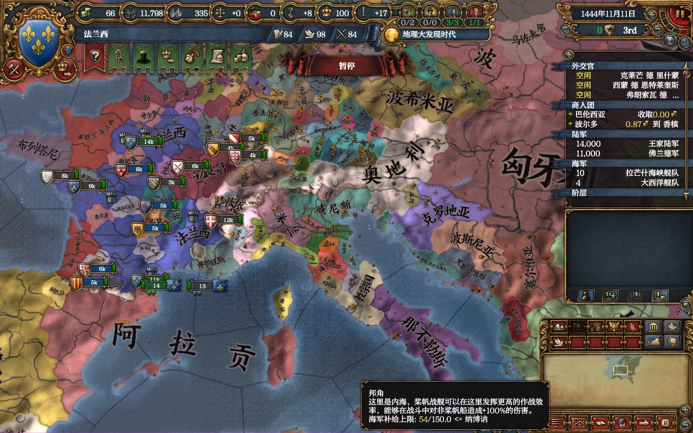
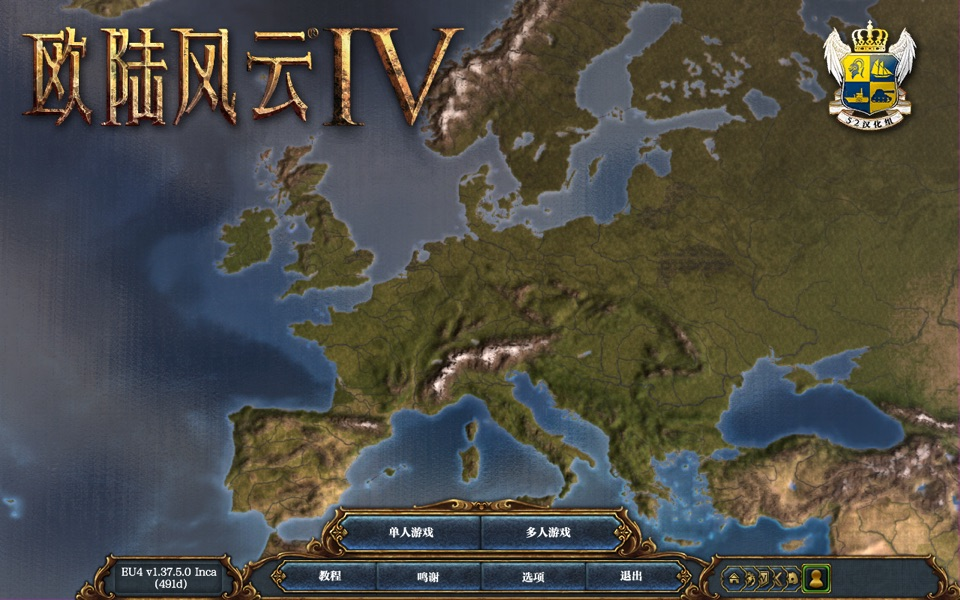

# eu4-mac-cjk

让苹果电脑 (Mac) 上的《欧陆风云4》能显示中文。

Windows 上显示中文要装 [EU4dll](https://github.com/matanki-saito/EU4dll) (双字节补丁), 它不支持苹果电脑。
这个项目照着它的做法, 给苹果版游戏写一个插件 (dylib, 苹果电脑上的「dll」)。

**还在做, 已经能用了:** 主菜单、进游戏以后的界面、提示框、地图上的国名省名都能显示中文。





- 游戏: Steam 版《欧陆风云4》1.37.5
- 中文模组: Steam 创意工坊「Chinese Language Mod for 1.37」(可以再加「Chinese Language Supplementary Mod for 1.37」)

## 怎么装

要先装好 Xcode 的命令行工具 (终端里打 `xcode-select --install`)。在这个文件夹里:

```sh
make                 # 编插件
tools/install.sh     # 装进游戏
```

装好以后照常从 Steam 开游戏, 在 Paradox 启动器里把中文模组加进模组列表就行。

- 装的时候会把原来的游戏程序备份成 `eu4.原版备份`, 插件放在 `eu4.app/Contents/Frameworks/libeu4cjk.dylib`。
- 还原: `tools/uninstall.sh`。
- Steam 更新游戏、或者「验证游戏文件完整性」以后, 插件会被冲掉, 再跑一次 `tools/install.sh` 就行。
- 出问题看日志: `~/Library/Logs/eu4-mac-cjk.log`。

## 现在还不行的

- 输入框打不进中文 (输入法)。
- 存档名里的中文会变成怪字 (存档能存, 名字不对)。
- 提示框换行时, 句号逗号可能跑到行首。
- 和平谈判、外交动作菜单、多人聊天、地图上临时弹出的字等还没试过。

非官方项目, 跟 Paradox 和 EU4dll 的作者都没有关系。

*A double-byte (CJK) text patch for the macOS version of Europa Universalis IV — a Mac counterpart of EU4dll. Work in progress.*

## 许可

MIT。做法参考了 EU4dll (MIT 许可)。
